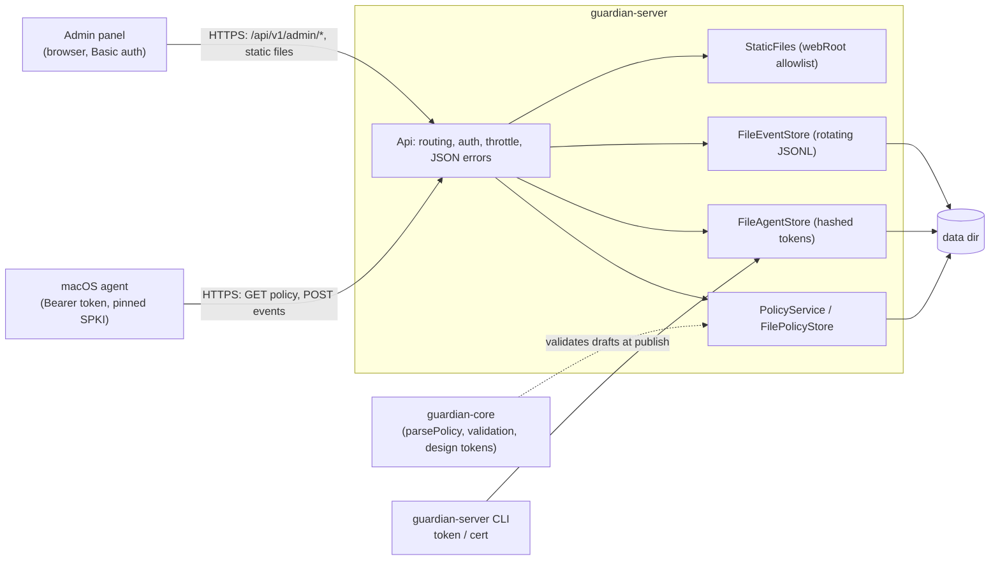

# guardian-server

> Formerly Warden.

Policy server and admin web panel of **Guardian**, a lightweight Endpoint DLP. C++17, runs on Windows (a small VPS) and macOS (development). It uses the shared rule engine from guardian-core to validate policies; it never evaluates file-access requests itself, the macOS agent does that. The server stores and publishes policy versions, collects the agents' decision events, and serves a small admin panel.

Design: [guardian-macos/docs/superpowers/specs/2026-10-20-guardian-design.md](https://github.com/EugeneHil/guardian-macos/blob/develop/docs/superpowers/specs/2026-10-20-guardian-design.md) (section 4.5 server, section 6 secrets, section 8 deployment).
Wire contract (source of truth for the agent): [docs/api.md](docs/api.md).

## Architecture



Layout of the data directory (default `data`, on the VPS `C:\guardian\data`); the stores write directly into it:

- `agents.json`: agent ids with hashed tokens
- `policies/vN.json`, `policies/active` (pointer to the active version), `policies/draft.json`
- `events.jsonl`, rotated to `events.1.jsonl`, ...

`cert generate` is independent of `dataDir`: by default it writes the certificate and private key to `data/tls` relative to the current working directory (pass `--out-dir` to choose another place).

Policy publishing is crash-safe: `vN.json` is written first, then the `active` pointer flips. A fresh server bootstraps an empty policy as v1, so the first publish is v2.

## Build, test, lint, coverage

Requires CMake 3.25+, Ninja and (on macOS) Homebrew `llvm` and `openssl@3`. Clone with `--recurse-submodules` (or run `git submodule update --init`) to fetch `external/guardian-core`.

```sh
cmake --preset macos            # or: windows (needs VCPKG_INSTALLATION_ROOT)
cmake --build --preset macos
ctest --preset macos
scripts/lint.sh                 # clang-format + clang-tidy, warnings are errors
scripts/coverage.sh             # line-coverage gate, MIN_COVERAGE defaults to 80
python3 -I -B -m unittest discover -s scripts   # script tests: coverage gate, design tokens (needs git on PATH), panel static checks, docs check
```

## Configuration

Settings come from a JSON file (by default the gitignored local config file in the working directory; override with `serve --config PATH`) and from environment variables, which win over the file. Only `config.example.json` is committed; copy it to the local config file and fill in the placeholders. Keys starting with `_` are ignored; unknown keys are an error.

| `config.example.json` key | Environment variable | Default | Meaning |
|---|---|---|---|
| `host` | `GUARDIAN_HOST` | `0.0.0.0` | listen address |
| `port` | `GUARDIAN_PORT` | `8443` | listen port, 1 to 65535 |
| `tls.certPath` | `GUARDIAN_TLS_CERT` | none | server certificate (PEM) |
| `tls.keyPath` | `GUARDIAN_TLS_KEY` | none | the TLS private key (PEM) |
| `allowInsecureHttp` | none | `false` | plain HTTP, accepted only when `host` is `127.0.0.1`, `::1` or `localhost` |
| `dataDir` | `GUARDIAN_DATA_DIR` | `data` | where the stores write |
| `webRoot` | `GUARDIAN_WEB_ROOT` | `web` | directory with the panel files |
| `adminPassword` | `GUARDIAN_ADMIN_PASSWORD` | none | admin password, at least 12 characters |

The server refuses to start (with a message per problem, never echoing secret values) when the password is shorter than 12 characters or TLS is not configured and plain HTTP is not explicitly allowed on a loopback host. An incomplete `tls` block is silently dropped when `allowInsecureHttp` is on. The server also refuses to start (exit 2) when any environment variable with the former product prefix is set: variables are renamed, not aliased. An existing install is migrated with [docs/vps-cutover.md](docs/vps-cutover.md).

## CLI reference

```text
guardian-server version
guardian-server help
guardian-server serve [--config PATH]
guardian-server token add <agentId> [--data-dir D]
guardian-server token list [--data-dir D]
guardian-server token remove <agentId> [--data-dir D]
guardian-server cert generate --host H [--out-dir D] [--days N]
guardian-server cert pin <certFile>
```

- Exit codes: `0` success, `1` runtime error, `2` usage error. `serve` also exits `0` after SIGINT/SIGTERM.
- `--data-dir` defaults to `GUARDIAN_DATA_DIR`, then `./data`.
- `token add` prints only the new token (`wdn_<64 hex>`) on stdout, once; a note goes to stderr. Agent ids use `A-Z a-z 0-9 . _ -`, 1 to 64 characters. Tokens are stored hashed. `token list` prints `<id> <createdAt>` lines.
- `cert generate` writes a self-signed ECDSA P-256 certificate (SAN = `--host`) and its private key into `--out-dir` (default `data/tls`, relative to the current directory; the key is written first with owner-only permissions). `--days` is 1 to 36500 (default 825). It refuses to overwrite existing files and prints `SPKI pin: <pin>`, the value the agent pins. `cert pin` recomputes it from a certificate.

## Admin panel

The server serves a dependency-free admin panel (`web/index.html`, `app.js`, `panel.css`, `tokens.css`) from `webRoot` at `/`; the browser's Basic-auth prompt supplies the admin credentials. The panel builds its DOM with `textContent` only and works under the CSP `default-src 'self'`.

`web/tokens.css` is generated from the guardian-core design tokens. After updating the submodule, regenerate it and commit the result; CI fails when it is stale:

```sh
python3 -I -B scripts/tokens.py          # regenerate web/tokens.css
python3 -I -B scripts/tokens.py --check  # exit 1 if it is stale
```

## Security notes

Threat model: the server listens on one TCP port, in the worst case reachable from the whole internet. Attackers may be anonymous network clients (probing, guessing credentials, sending hostile bodies), the holder of a stolen or leaked agent token, or a network observer. The admin is one trusted person. A host running an agent is trusted only as far as its token allows. The controls below assume nothing about the network; narrowing who can reach the port is a layer underneath them, not a replacement for them, and the reference deployment adds it by keeping 8443 inside a VPN ([docs/vps-setup.md](docs/vps-setup.md), step 2).

Controls:

- TLS only (plain HTTP just on loopback for development). The agent pins the certificate's SPKI hash instead of trusting a CA.
- Fail closed: no admin password of 12+ characters or no TLS means no start. Every non-agent route, including the static panel, requires admin auth; an admin panel reachable without authentication is a release blocker.
- Agent tokens are random, stored hashed, and revocable at once (`token remove`, applied live). The `agentId` always comes from the token, never from a payload.
- 5 consecutive failed authentications per remote address lock it out for 60 s (`429`). Bodies are capped at 1 MiB; event batches at 500 items with strict UTF-8, nesting and string-size limits.
- Errors are generic JSON; secrets, tokens, passwords and `Authorization` values are never logged. The access log records only address, method, path (no query) and status.
- Secrets (TLS key, admin password) come from the environment or the local config file, never from the repository.

Known limitations:

- **Event delivery is at-least-once.** A batch is appended event by event; a storage failure midway can persist a prefix and return 5xx, and agent retries can duplicate events. There is no server-side de-duplication.
- **No cross-process lock on `agents.json`.** Two concurrent `token add/remove` runs can lose an update (last writer wins). The server only reads the file, and re-reads it on each authentication. The policy store caches the active version in memory, so the running server must be the sole policy writer.
- **One throttle per realm and address.** The agent routes and the admin routes each count failures separately for a remote address (a success in one realm never resets the other), so a NAT neighbour's bad tokens can lock that realm out for the whole address. Locked-out addresses are refused even with valid credentials. `404`/`405` answers do not count.
- **Windows: CLI token changes can race with the server.** The server re-reads `agents.json` on each authentication; a `token add/remove` that overlaps such a read can fail on Windows because of file sharing rules. Retry the command.
- **Password length leaks.** The admin password comparison is constant-time except that it reveals the length; it is rate-limited and only reachable over TLS.
- **Slow-client exhaustion.** The HTTP thread pool is bounded (by cores), reads time out after 10 s, the accept queue is unbounded. Accepted for a firewalled single-admin deployment: restrict TCP 8443 to known addresses at the firewall, or to a VPN subnet.
- **Static files follow symlinks inside `webRoot` and have no size cap**, so `webRoot` must be operator-controlled.
- **Windows file permissions are best-effort.** The `ownerOnly` mode cannot express ACLs; the ACLs of the parent directory protect the TLS private key and `agents.json`, and the install script sets them. Sockets use `SO_EXCLUSIVEADDRUSE`, so a quick restart may fail to bind while old connections linger.
- **Publishing:** a failure to clear the draft after a successful commit reports an error although the new version is active (a retry publishes the same content again as N+2). Validation errors from guardian-core may echo admin-supplied keys or ids.
- **Panel:** the Basic-auth prompt is the browser's; the CSP applies to the HTML document only. The visual browser check is the owner's checklist.
- `src/cli.cpp` assembles a few secret-looking default file names from adjacent string literals purely to keep the repository's guard hook quiet.

Policy semantics are guardian-core's (blocklist, default allow); the server validates with `guardian::parsePolicy` and refuses to publish an invalid policy.

## Deployment overview

The target is a small Windows VPS: build with the `windows` preset (vcpkg supplies OpenSSL), generate the certificate with `cert generate --host <vps-ip>`, create agent tokens with `token add`, run `serve` as a Windows service hosted by NSSM ([ADR 0002](docs/adr/0002-windows-service-nssm.md)), and open TCP 8443 only to the addresses that need it. Step-by-step instructions: [docs/vps-setup.md](docs/vps-setup.md). Dependencies and pins: [ADR 0001](docs/adr/0001-server-dependencies.md).

## Roadmap

- SQLite storage instead of JSON files (atomic multi-record updates, no cross-process races)
- Per-agent token revocation list visible in the admin UI
- Policy history and rollback
- Rate limits per agent, not only per address
- mTLS between agent and server
- Server-side de-duplication of events
- Signed policies verified by the agent

## Layout

- `src/` server sources (`main.cpp` is the thin entry point)
- `tests/` GoogleTest unit tests (`*_test.cpp`)
- `external/guardian-core` shared rule engine (git submodule)
- `cmake/` warnings and dependency modules
- `web/` admin panel (static files)
- `scripts/` lint, coverage, design-token and docs gates
- `docs/` API reference and ADRs
